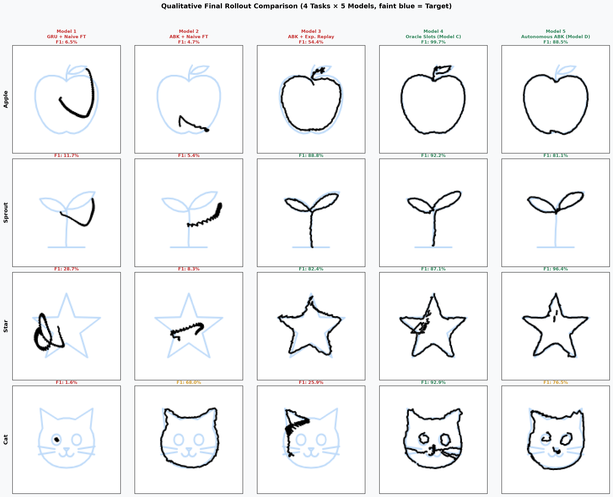
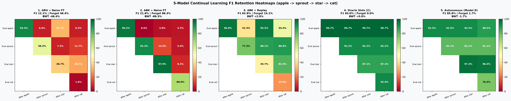
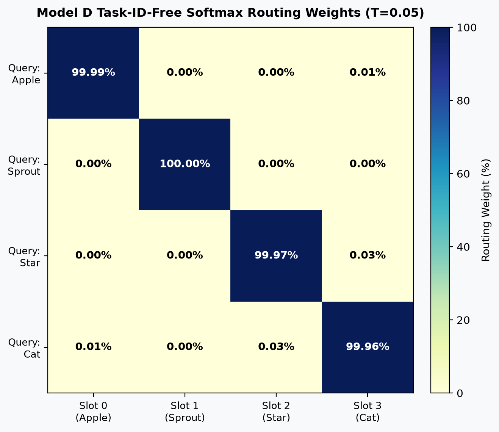
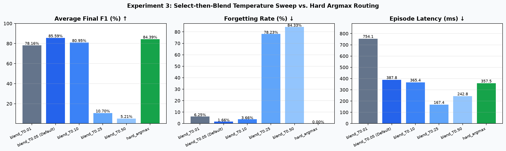
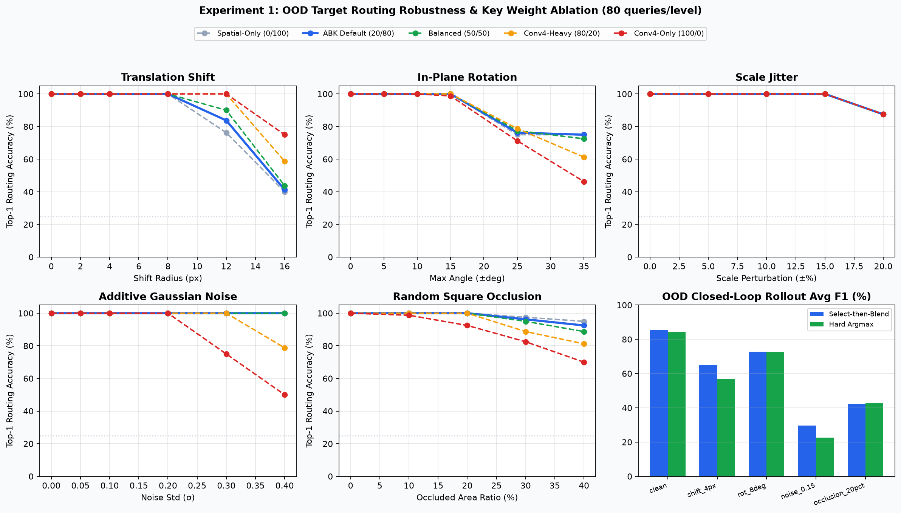
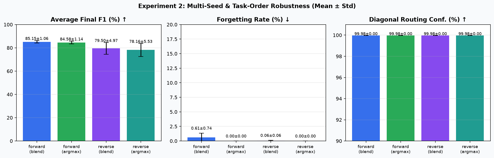
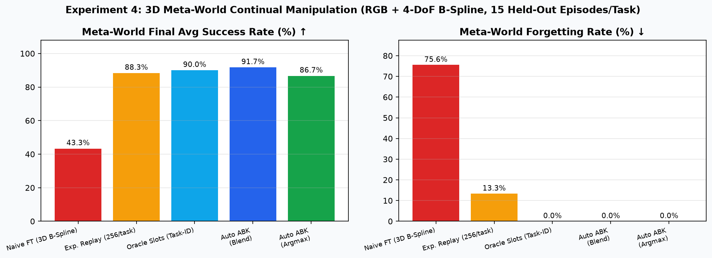

# ABK-VLA: Task-ID-Free Continual Visuomotor Policy Learning via Autonomous B-Spline Knot Compression

[](https://www.python.org/)
[](https://pytorch.org/)
[](#)
[](#)
[](./paper/ABK_VLA_Preprint.pdf)
[](https://doi.org/10.5281/zenodo.24208545)

> **Follow-up Architecture (DTRA):** Our standalone successor scaling to 8 continual 3D Meta-World tasks with \$O(1)\$ CPU inference and Elastic Snap-Back of Hypertube Rings is published at **[https://github.com/5Color/dtra](https://github.com/5Color/dtra)**.

> **Can a lightweight visuomotor policy learn sequential multi-stroke manipulation tasks without catastrophic forgetting, without an experience replay buffer, and without ground-truth `Task-ID` labels at inference time?**

**ABK-VLA (Autonomous B-spline Knot-based Visuomotor Policy)** addresses sequential continual learning in compact closed-loop trajectory control. While massive foundation models dilute forgetting through over-parameterization and large-scale replay, lightweight visuomotor policies suffer severe trajectory collapse (`46.44%–89.33%` forgetting) under sequential fine-tuning.

By compressing $H = 16$ action chunks into $N_k = 6$ **cubic B-spline control knots** and pairing frozen visual-spatial backbone representations (`4.59M` shared parameters) with lightweight residual Winner-Take-All (WTA) slot heads (`0.33M` parameters per residual slot, `7.16%` of the backbone, `94.44%` total model frozen at $T_3$) and **task-ID-free visual prototype routing (`Select-then-Blend`, $T = 0.05$)**, ABK-VLA achieves **`99.98%` average diagonal routing confidence (`4/4` slot match on canonical targets)**, **`1.66%` forgetting rate**, and **`85.59%` average final $F_1$** across a 4-task sequential benchmark (`apple → sprout → star → cat`)—recovering **`92.1%` of the external-`Task-ID` Oracle baseline (`92.96%`)** without any replay data or test-time task labels.

*(For the earlier Phase 1 closed-loop ACT baseline and crowdsourced web benchmark, see [`paper/main.tex`](./paper/main.tex), [`Drawing_VLA.pdf`](https://github.com/5Color/drawing-vla/blob/main/Drawing_VLA.pdf), and [5Color/drawing-vla](https://github.com/5Color/drawing-vla).)*

---

## 1. Visual Highlights

### Qualitative 5-Model Rollout Comparison (`apple → sprout → star → cat`)
After sequentially learning all four tasks, naive fine-tuning baselines (`Model 1`, `Model 2`) collapse on earlier tasks, and experience replay (`Model 3`) degrades on complex multi-part geometry (`Cat` $F_1 = 25.9\%$). **Autonomous ABK-VLA (`Model 5`)** preserves structural fidelity across all four tasks without external test-time task labels.



### Sequential $F_1$ Retention Heatmaps & Task-ID-Free Visual Routing Matrix
| Sequential $F_1$ Retention Across 4 Tasks | Task-ID-Free Softmax Routing ($T = 0.05$) |
| :---: | :---: |
|  |  |

---

## 2. 5-Model Continual Learning Benchmark

All five models were evaluated on **Intel(R) Arc Graphics (`xpu`, FP32, PyTorch `2.15.0+xpu`, `seed=42`)** using identical dataset splits (`85%` train / `15%` val by episode), identical curriculum and augmentation schedules (`T0: apple` `10 epochs × 1× aug`, `T1: sprout` `12 epochs × 3× aug`, `T2: star` `12 epochs × 5× aug`, `T3: cat` `16 epochs × 5× aug`, `batch_size=64`, `WeightedRandomSampler` for multi-stroke tasks), identical spatial pointers (`compute_res_cue` + `compute_spatial_pointer`), post-hoc chunk-boundary $C^0/C^1$ continuity smoothing, and rollout parameters (`exec_steps=16`, `max_iters=100`, base `patience=8` dynamically extended to `effective_patience=16` when $>5\%$ target ink remains).

> **Protocol Note on Optimizer & Head Differences:** In `experiments/benchmark_autonomous_cl.py`, `T0` uses `lr=3e-4` for all models; for `T1–T3`, single-mode `Models 1–3` use `lr=3e-4`, whereas slot-isolated 6-mode WTA `Models 4–5` use `lr=1e-3` (`Model 5` `prior_weight` uses `5e-3`). `Model 4` uses `WTASlotHead` (`0.30M`) with cross-entropy gating loss, whereas `Model 5` uses `ResidualWTASlotHead` (`0.33M`) with pointer-conditioned mode selection, focal gating loss, and pen-consistent supervision.

| Evaluation Axis | Metric | Model 1<br>`GRU + Naive FT` | Model 2<br>`ABK + Naive FT` | Model 3<br>`ABK + Replay` | Model 4 (Oracle)<br>`ABK Slots (C)` | **Model 5 (Ours)**<br>**`Autonomous ABK (D)`** |
| :--- | :--- | :---: | :---: | :---: | :---: | :---: |
| **Conditions** | **Inference `Task-ID`** | None | None | None | Required (Oracle) | **None (Autonomous)** |
| | **Replay Buffer** | None | None | `256` samples/task | None | **None (Zero Replay)** |
| | **Slot Head / Modes** | GRU (`H=16`) | Single-mode MLP | Single-mode MLP | 6-mode WTA (`0.30M`) | **6-mode Residual WTA (`0.33M`)** |
| **Task Precision** | `Apple (T0)` $F_1 \uparrow$ | 6.5% | 4.7% | 54.4% | **99.7%** | 88.5% |
| | `Sprout (T1)` $F_1 \uparrow$ | 11.7% | 5.4% | 88.8% | **92.2%** | 81.1% |
| | `Star (T2)` $F_1 \uparrow$ | 28.7% | 8.3% | 82.4% | 87.1% | **96.4%** |
| | `Cat (T3)` $F_1 \uparrow$ | 1.6% | 68.0% | 25.9% | **92.9%** | 76.5% |
| | **Avg Final $F_1 \uparrow$** | 12.12% | 21.61% | 62.87% | **92.96%** | **85.59% (92.1% of Oracle)** |
| **Continual Learning** | **Forgetting Rate $\downarrow$** | 46.44% | 89.33% | 14.13% | **0.00%** | **1.66% (54.0× vs Naive FT)** |
| | **Backward Transfer (BWT)** | -46.44% | -89.33% | +1.95% | 0.00% | **-1.66%** |
| **Geometry & Control** | **Chamfer Distance $\downarrow$** | 0.1043 | 0.0984 | 0.0327 | **0.0098** | **0.0192 (5.4× vs GRU)** |
| | **Normalized Mean Jerk $\downarrow$** | 5.05 | 5.91 | 5.92 | **3.09** | **3.33** |
| | **Component Recall $\uparrow$** | 0.0% | 6.3% | 50.0% | **87.5%** | **62.5% (+12.5%p vs Replay)** |
| **Efficiency** | **Episode Latency $\downarrow$** | 601.6 ms | 108.6 ms | 564.9 ms | 346.6 ms | **464.3 ms (1.30× vs GRU)** |
| | **T3 Trainable Params** | 5.08M (Full) | 4.72M (Full) | 4.72M (Full) | 0.30M (Slot) | **0.33M (94.44% Frozen)** |

---

## 3. Core Architectural Mechanisms (`train/bspline_policy.py` & `train/rollout_bspline.py`)

1. **Cubic B-Spline Trajectory Compression (`BSplineDecoder`):**
   Instead of predicting $H = 16$ raw Cartesian waypoints, each slot predicts $N_k = 6$ sigmoid-bounded control knots $\mathbf{P} \in (0, 1)^{6 \times 2}$ and step-wise pen logits $\mathbf{u} \in \mathbb{R}^{16}$, mapped analytically via a frozen cubic B-spline design matrix $\hat{\mathbf{Y}} = \mathbf{B}\mathbf{P}$. During closed-loop rollout (`rollout_bspline.py`), continuous pen-down transitions apply post-hoc chunk-boundary smoothing ($\hat{\mathbf{y}}_0 \leftarrow \mathbf{p}_{\text{prev}}$ for $C^0$, and $\hat{\mathbf{y}}_1 \leftarrow 0.7\,\hat{\mathbf{y}}_1 + 0.3\,(\mathbf{p}_{\text{prev}} + \mathbf{v}_{\text{prev}})$ when $\cos\alpha > 0$ for $C^1$ tangent continuity), yielding smooth control (`NMJ = 3.33`).
2. **Thin-Stroke Spatial Pointer & Residual Cue (`compute_spatial_pointer`, `compute_res_cue`):**
   From the uncovered target residual $\mathbf{M}_{\text{uncov}} = \max(0, \mathbf{I}_{\text{target}} - \mathbf{I}_{\text{canvas}})$, the policy extracts:
   * A **64-d** $8 \times 8$ adaptive average-pooled residual cue (`compute_res_cue`, scaled by `4.0`).
   * A **7-d** geometric spatial pointer (`[cx, cy, rem_ratio, dx_center, dy_center, dx_near, dy_near]`), where nearest uncovered pixels are located via a blended salience map `0.7 * uncov + 0.3 * AvgPool3x3(uncov)` (thresholded at `> 0.15`, fallback `> 0.08`) to preserve thin 1 px stems, leaves, and whiskers.
3. **5,376-d Hybrid Prototype Key & Select-then-Blend Residual Routing (`AutonomousABKPolicy`):**
   * **Prototype Key (`_compute_target_key`):** Concatenates L2-normalized Conv4 `4×4` pooled features (`4,096-d`, weight `0.5`) with L2-normalized multi-scale target silhouette average pooling (`32×32` smoothed + `16×16` = `1,280-d`, weight `1.0`), followed by final L2 normalization (`5,376-d`).
   * **Select-then-Blend Inference (`predict`):** Rather than hard `argmax` routing over a single slot, `AutonomousABKPolicy` caches the static target key and softmax routing weights $\mathbf{w}$ ($T = 0.05$) per episode (`reset_cache()`), evaluates all $K$ `ResidualWTASlotHead` modules sequentially with logit-space residual composition (`sigmoid(prior_weight * logit(base_cp) + delta_cp)`), selects the highest-scoring WTA mode within each slot (`argmax` over `sel_head`), and computes a $\mathbf{w}$-weighted average across all slots.
   * **Routing & Forgetting Trade-off:** On the 4 canonical target templates, diagonal softmax routing weights are **`99.99%` (`Apple`), `100.00%` (`Sprout`), `99.97%` (`Star`), and `99.96%` (`Cat`)** (`99.98%` mean diagonal weight, `4/4` slot match). Because soft Select-then-Blend includes tiny off-diagonal tail weights ($<0.04\%$) from subsequently added residual slots, closed-loop rollout on frozen earlier tasks (`Apple`: `92.48% → 88.46%`, `Star`: `97.30% → 96.36%`) exhibits a slight `1.66%` forgetting rate.
   * **Episode Latency:** Evaluating all 4 slots with `reset_cache()` yields **`464.3 ms`** per episode (`7.02 ms` per chunk) inside the 5-model sequential training-and-evaluation benchmark (`benchmark_autonomous_cl.py`, Table 1)—**`1.30×` faster than `GRU` (`601.6 ms`)** and **`1.22×` faster than `ABK + Replay` (`564.9 ms`)**, while remaining slower than single-slot `Model 4` (`346.6 ms`) and early-stalling `Model 2` (`108.6 ms`). *(Note: When re-evaluating the saved checkpoint `outputs/autonomous_model_d_final.pth` standalone in `Exp 3`, `Blend T=0.05` runs at `387.8 ms` vs `357.5 ms` for `Hard Argmax` under identical standalone timing conditions.)*
4. **Full-Chunk Horizon Alignment (`exec_steps=16`):**
   Executing the complete $H = 16$ horizon (`exec_steps=16`) prevents premature truncation of pen-up jump trajectories before touchdown on disconnected components.

---

## 3B. Follow-Up Stress Tests & 3D Generalization (Experiments 1–4)

To stress-test every theoretical and empirical claim under strict continual learning conditions, we added four follow-up benchmarks:

| Experiment | Script | Key Verified Result | Figure |
| :--- | :--- | :--- | :---: |
| **Exp 1: OOD Routing & Key Ablation** | [`experiments/eval_routing_perturbation.py`](experiments/eval_routing_perturbation.py) | Hybrid key (`0.5·Conv4 + 1.0·Spatial`) keeps **100.0%** routing up to ±8 px shift, ±15° rotation, ±15% scale, `sigma=0.40` noise, and 20% occlusion (`92.5%` at 40%); balanced 50/50 reaches **90.0%** at ±12 px. *(Closed-loop OOD F1: `65.04%` Blend / `56.97%` Argmax at 4 px shift, `72.78%` / `72.59%` at 8° rot, `29.55%` / `22.49%` at `sigma=0.15` noise.)* | [Perturbation Curve](outputs/exp1_routing_perturbation.png) |
| **Exp 2: 3-Seed & Task-Order Robustness** | [`experiments/benchmark_multiseed_order.py`](experiments/benchmark_multiseed_order.py) | Across seeds `{42, 43, 44}`, **Forward** achieves `85.15 ± 1.06%` F1 (`FR = 0.61 ± 0.74%`) under Blend and `84.58 ± 1.14%` (`FR = 0.00 ± 0.00%`) under Argmax; **Reverse** achieves `79.50 ± 4.97%` (`FR = 0.06 ± 0.06%`) vs `78.16 ± 5.53%` (`FR = 0.00 ± 0.00%`). | [Multi-Seed Order](outputs/exp2_multiseed_order.png) |
| **Exp 3: Select-then-Blend vs Hard Argmax** | [`experiments/eval_argmax_vs_blend.py`](experiments/eval_argmax_vs_blend.py) | On saved checkpoint `outputs/autonomous_model_d_final.pth`, switching to `hard_argmax` eliminates residual tail-weight forgetting completely (**FR: 1.66% → 0.00%**, standalone Latency **387.8 ms → 357.5 ms**) while Default Blend (`T=0.05`) preserves slightly higher transfer (`85.59%` vs `84.39%` F1). | [Argmax vs Blend](outputs/exp3_argmax_vs_blend.png) |
| **Exp 4: 3D Meta-World Manipulation** | [`experiments/benchmark_metaworld_cl.py`](experiments/benchmark_metaworld_cl.py) | Ported directly to 4-DoF 3D MuJoCo manipulation (`button-press-v3 -> door-open-v3 -> window-open-v3 -> faucet-open-v3`) with 128×128 RGB + 4-d EEF & DoG+Conv4 key: **91.7% Avg SR / 0.0% FR / +11.1% BWT** (**100.0% autonomous routing accuracy without test-time `Task-ID`**, `99.71%` conf) vs Naive FT `43.3% / 75.6% FR`, Replay `88.3% / 13.3% FR`, Oracle Slots `90.0%`. | [Meta-World 3D CL](outputs/exp4_metaworld_cl.png) |

<p align="center">
  
  
</p>
<p align="center">
  
  
</p>

### Meta-World 3D Continual Manipulation Summary (`outputs/exp4_metaworld_cl.json`)

| Method | Test-Time `Task-ID`? | Replay? | Final Avg SR $\uparrow$ | FR $\downarrow$ | BWT $\uparrow$ | Autonomous Routing (No `Task-ID`) | Total Params |
| :--- | :---: | :---: | :---: | :---: | :---: | :---: | :---: |
| Naive FT (1-Head B-Spline) | Not Used | No | 43.3% | 75.6% | -75.6% | — | 1.60M |
| Experience Replay (256/task) | Not Used | Yes | 88.3% | 13.3% | -13.3% | — | 1.60M |
| Oracle Slots (External ID) | **Required** | No | 90.0% | 0.0% | +0.0% | Oracle-Selected | 2.19M |
| **Autonomous 3D ABK (Hard Argmax)** | **None** | **No** | 86.7% | **0.0%** | +0.0% | **100.0%** (No `Task-ID`) | 2.19M |
| **Autonomous 3D ABK (Select-then-Blend)** | **None** | **No** | **91.7%** | **0.0%** | **+11.1%** | **100.0%** (No `Task-ID`) | 2.19M |

---

## 4. Scope & Honest Limitations

To ensure transparent scientific interpretation, we explicitly define the operational boundaries of this study:
* **Goal-Image / Visual-Only Conditioning & Simulation Testbeds:** In this repository, "ABK-VLA" denotes a compact **vision-and-proprioception** visuomotor action-chunking policy validated on a 2D multi-stroke drawing testbed and a 3D Meta-World (`MuJoCo`) continual manipulation benchmark (Experiments 1–4). The current implementation does not include a language encoder/VLM backbone or physical hardware validation.
* **Training Task Boundaries, OOD Sensitivity & Narrow 3D Margin:** Inference is `Task-ID`-free, though sequential training invokes `register_or_expand_slot` at discrete task boundaries. Experiment 1 confirms `100.0%` routing accuracy up to ±8 px shift, ±15° rotation, ±15% scale, `sigma=0.40` noise, and 20% occlusion (`92.5%` at 40%), while closed-loop OOD rollout F1 drops under stronger target corruptions (`65.04%` at 4 px shift, `29.55%` at `sigma=0.15` noise). In 3D Meta-World, subtracting a 15×15 local average (DoG residual) and using 8 initial-frame exemplars (`T=0.003`, `threshold=0.996`) yields a raw $T_3$ cosine margin of `0.0168` (`0.9792` vs. `0.996`) and assumes distinct initial ($t=0$) scene layouts.
* **Linear $O(K)$ Slot Chaining & Blend-vs-Argmax Trade-Off:** Both slot memory (`0.33M`/slot in 2D, `5.90M` total at $T_3$; `0.19M`/slot in 3D, `2.19M` total at $T_3$) and sequential residual chaining scale linearly as $O(K)$, even under `hard_argmax`. Experiment 3 confirms that switching from `Select-then-Blend` (`T=0.05`) to `hard_argmax` eliminates the residual tail-weight forgetting (`1.66%` → `0.00%` FR; standalone latency `387.8 ms` → `357.5 ms`) at the cost of a minor `-1.20 pp` transfer reduction (`84.39%` vs. `85.59%` F1).

---

## 5. Repository Structure & Quickstart

```text
abk-vla/
├── README.md                              # Project overview, benchmark tables, and visual results
├── requirements.txt                       # Core Python dependencies (+ optional 3D Meta-World packages)
├── .zenodo.json                           # Zenodo DOI archival metadata (Son, Seungjoon / MIT)
├── RELEASE_NOTES_v1.1.2.md                # Release notes for GitHub Release v1.1.2
├── RELEASE_NOTES_v1.1.3.md                # Release notes for GitHub Release v1.1.3
├── paper/
│   ├── ABK_VLA_Paper.tex                  # Full two-column LaTeX preprint manuscript
│   ├── ABK_VLA_Preprint.pdf               # Compiled 9-page OpenType preprint PDF
│   └── main.tex                           # Phase 1 Drawing-VLA ACT manuscript
├── data/
│   └── bspline/                           # Preprocessed 4-task B-spline datasets (H=16, Nk=6, stride=8)
│       ├── bspline_vla_dataset_apple_m6_h16_s8.npz
│       ├── bspline_vla_dataset_sprout_m6_h16_s8.npz
│       ├── bspline_vla_dataset_star_m6_h16_s8.npz
│       └── bspline_vla_dataset_cat_m6_h16_s8.npz
├── train/
│   ├── bspline_policy.py                  # AutonomousABKPolicy (blend & argmax), BSplineModelCPolicy, GRU, MLP
│   ├── rollout_bspline.py                 # Closed-loop rollout engine, post-hoc C0/C1 & stall patience
│   └── dataset.py                         # Observation rendering and trajectory utilities
├── tools/
│   ├── bspline_core.py                    # Clamped cubic B-spline basis, BVLS fitting, BSplineDecoder
│   └── bspline_augment.py                 # Equivariant affine/elastic/covariate augmentation & pen loss
├── experiments/
│   ├── benchmark_autonomous_cl.py         # 5-model continual learning benchmark runner
│   ├── benchmark_three_models.py          # Shared data loader, device utilities, and 3-model runner
│   ├── eval_routing_perturbation.py       # [Exp 1] OOD perturbation routing curves, key ablation & rollout F1
│   ├── benchmark_multiseed_order.py       # [Exp 2] 3-seed ({42,43,44}) Forward & Reverse task-order benchmark
│   ├── eval_argmax_vs_blend.py            # [Exp 3] Select-then-Blend (T sweep) vs Hard Argmax comparison
│   └── benchmark_metaworld_cl.py          # [Exp 4] 3D Meta-World MuJoCo 4-task continual manipulation benchmark
├── tests/
│   ├── test_bspline_core.py               # Unit tests for B-spline basis and BVLS fitting
│   └── test_bspline_policy.py             # Unit tests for policy architectures, blend/argmax, and loss interfaces
└── outputs/
    ├── autonomous_cl_benchmark.json       # Raw 5-model benchmark metrics & routing matrix
    ├── autonomous_cl_rollout_grid.png     # 4x5 qualitative rollout comparison grid
    ├── autonomous_cl_heatmap.png          # 5-model F1 retention heatmaps
    ├── autonomous_routing_matrix.png      # 4x4 Task-ID-free softmax routing matrix
    ├── autonomous_model_d_rollout.png     # Model D standalone rollout grid
    ├── autonomous_model_d_final.pth       # Trained 4-task AutonomousABKPolicy checkpoint
    ├── exp1_routing_perturbation.{json,png}
    ├── exp2_multiseed_order.{json,png}
    ├── exp3_argmax_vs_blend.{json,png}
    └── exp4_metaworld_cl.{json,png}
```

### Installation
```bash
pip install -r requirements.txt
```

### Run the 5-Model Continual Learning Benchmark
```bash
python experiments/benchmark_autonomous_cl.py \
  --tasks apple sprout star cat \
  --epochs-t0 10 \
  --epochs-slot 12 \
  --batch-size 64 \
  --max-iters 100 \
  --exec-steps 16 \
  --seed 42
```

### Re-Run Model D Only (Updating `outputs/autonomous_cl_benchmark.json`)
```bash
python experiments/benchmark_autonomous_cl.py \
  --only-model-d \
  --tasks apple sprout star cat \
  --exec-steps 16 \
  --num-modes 6 \
  --temperature 0.05 \
  --novelty-threshold 0.85
```

### Run Unit Tests & Follow-Up Verification (Experiments 1–4)
```bash
# Core B-spline & policy unit tests (9 tests)
python -m unittest tests/test_bspline_core.py tests/test_bspline_policy.py -v

# Exp 1: OOD perturbation routing curves, key weight ablation & closed-loop OOD F1
# (reads outputs/autonomous_model_d_final.pth & outputs/autonomous_cl_benchmark.json)
python experiments/eval_routing_perturbation.py

# Exp 2: 3-seed ({42,43,44}) Forward & Reverse task-order benchmark
python experiments/benchmark_multiseed_order.py --seeds 42 43 44 --orders forward reverse --epochs-t0 10 --epochs-slot 12

# Exp 3: Select-then-Blend (T sweep) vs Hard Argmax slot routing
# (reads outputs/autonomous_model_d_final.pth & outputs/autonomous_cl_benchmark.json)
python experiments/eval_argmax_vs_blend.py

# Exp 4: 3D Meta-World 4-task continual manipulation (requires gymnasium, mujoco, metaworld)
python experiments/benchmark_metaworld_cl.py --epochs 55 --n-demos 30 --n-eval 15 --seed 42
```
